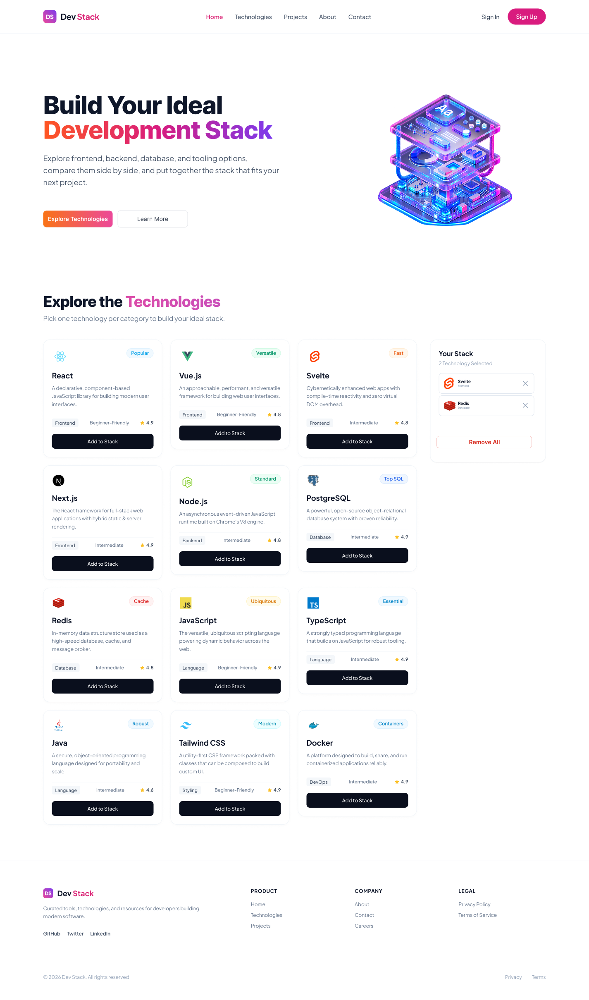

# 🚀 Dev Stack

**Dev Stack** is a responsive, modern web application built with React, TypeScript, and Tailwind CSS. It lets developers explore popular technologies — frontend, backend, database, language, styling, and DevOps — and curate their own ideal development stack.



---

## 📋 Table of Contents

- [Features](#-features)
- [Tech Stack](#-tech-stack)
- [Project Structure](#-project-structure)
- [Getting Started](#-getting-started)
- [Usage](#-usage)
- [Responsive Design](#-responsive-design)
- [Gradient Theme](#-gradient-theme)
- [NPM Packages Used](#-npm-packages-used)

---

## ✨ Features

| Feature | Description |
|---|---|
| 🧭 **Sticky Navbar** | Responsive navbar with brand logo, nav links, and auth buttons. Collapses into a hamburger menu on mobile. |
| 🦸 **Hero Banner** | Eye-catching hero section with a two-tone gradient heading, description, and two CTA buttons. |
| 🃏 **Technology Cards** | Displays all technologies in a responsive 3-column grid. Each card shows icon, badge, name, description, category, difficulty, rating, and an "Add to Stack" button. |
| 📦 **Your Stack Sidebar** | A live sidebar where users can track selected technologies. Shows selected count, allows individual or bulk removal. |
| 🚫 **Duplicate Guard** | Prevents adding the same technology twice — shows a warning toast instead. |
| 🔔 **Toast Notifications** | Real-time feedback via `react-toastify` for add, duplicate, remove, and remove-all actions. |
| ⏳ **Loading State** | Animated spinner shown while technology data is being fetched from `data.json`. |
| 🎨 **Single Gradient Theme** | One CSS variable controls the brand gradient (orange → pink → violet) applied to the brand name, hero heading, and primary buttons. |
| 📱 **Fully Responsive** | Optimized layout for mobile, tablet, and desktop screens. |
| 🦶 **Footer** | Brand block with social links (GitHub, Twitter, LinkedIn) and three link groups: Product, Company, and Legal. |

---

## 🛠 Tech Stack

| Technology | Version | Purpose |
|---|---|---|
| [React](https://react.dev/) | ^19 | UI component library |
| [TypeScript](https://www.typescriptlang.org/) | ~6.0 | Static type safety |
| [Tailwind CSS](https://tailwindcss.com/) | ^4.3 | Utility-first CSS styling |
| [Vite](https://vite.dev/) | ^8.3 | Lightning-fast dev server & bundler |
| [react-toastify](https://fkhadra.github.io/react-toastify/) | ^11 | Toast notification system |

---

## 📁 Project Structure

```
L1B14A05_DevStack/
├── public/
│   ├── data.json              # Technology data API (12 technologies)
│   ├── favicon.svg
│   └── *.png                  # Reference UI images
├── src/
│   ├── assets/
│   │   ├── banner-stack.png   # Hero section illustration
│   │   ├── hamburger.png      # Mobile menu icon
│   │   └── logo-text.png      # Brand logo
│   ├── components/
│   │   ├── Navbar.tsx         # Sticky navbar (desktop + mobile)
│   │   ├── Banner.tsx         # Hero / banner section
│   │   ├── TechSection.tsx    # Data fetching, grid layout, stack state
│   │   ├── TechCard.tsx       # Individual technology card
│   │   ├── YourStack.tsx      # Stack sidebar panel
│   │   └── Footer.tsx         # Site footer
│   ├── types.ts               # Shared TypeScript interfaces
│   ├── App.tsx                # Root layout component
│   ├── main.tsx               # App entry point + ToastContainer
│   └── index.css              # Global styles + brand gradient variable
├── index.html                 # HTML shell with Inter font & SEO meta
├── vite.config.ts
├── tsconfig.json
└── package.json
```

---

## 🚀 Getting Started

### Prerequisites

- [Node.js](https://nodejs.org/) v18 or higher
- npm v9 or higher

### Installation

```bash
# 1. Clone the repository
git clone https://github.com/your-username/L1B14A05_DevStack.git

# 2. Navigate into the project directory
cd L1B14A05_DevStack

# 3. Install dependencies
npm install

# 4. Start the development server
npm run dev
```

The app will be available at **http://localhost:5173**

### Other Scripts

```bash
npm run build     # Type-check and build for production
npm run preview   # Preview the production build locally
npm run lint      # Run OxLint for code quality checks
```

---

## 📖 Usage

### Adding a Technology to Your Stack
1. Browse the **Technologies** section.
2. Click **"Add to Stack"** on any technology card.
3. The card button changes to **"✓ Added to Stack"** (disabled).
4. The technology appears in the **Your Stack** sidebar.
5. A success toast confirms the action.

### Removing Technologies
- Click the **✕** button beside a stack item to remove it individually.
- Click **"Remove All"** to clear the entire stack at once.
- Both actions trigger an informational toast notification.

### Duplicate Prevention
Attempting to add an already-selected technology triggers a **warning toast** — it will not be added again.

---

## 📱 Responsive Design

| Screen | Navbar | Tech Grid | Your Stack |
|---|---|---|---|
| Mobile (< 768px) | Hamburger + logo + auth buttons | 1 column | Below grid |
| Tablet (768px – 1024px) | Full desktop nav | 2 columns | Below grid |
| Desktop (> 1024px) | Full desktop nav | 3 columns | Sticky sidebar |

---

## 🎨 Gradient Theme

The entire brand gradient is defined in a **single CSS variable** in `src/index.css`:

```css
:root {
  --brand-gradient: linear-gradient(90deg, #f97316, #ec4899, #8b5cf6);
}
```

This one value drives:
- The **brand name** in the Navbar and Footer
- The **hero heading** highlight text
- All **primary CTA buttons** (Explore Technologies, Sign Up)
- The **selected count** text in Your Stack

Change `--brand-gradient` once to re-theme the entire site instantly.

---

## 📦 NPM Packages Used

### `react-toastify`

Used to display contextual toast notifications throughout the app:

| Event | Toast Type |
|---|---|
| Technology added to stack | ✅ `toast.success` |
| Duplicate add attempt | ⚠️ `toast.warning` |
| Technology removed | 🗑️ `toast.info` |
| All technologies removed | 🧹 `toast.error` |

Configured in `src/main.tsx` with `position="top-right"`, `autoClose={3000}`, and `theme="light"`.

---

## 🙌 Acknowledgements

- Technology icons sourced from [icepanel.io](https://icon.icepanel.io/)
- Banner illustration included in project assets
- Font: [Inter](https://fonts.google.com/specimen/Inter) via Google Fonts

---

## 📄 License

This project is for educational purposes as part of the **Programming Hero** Level 1 Batch 14 course.

© 2026 Dev Stack. All rights reserved.
